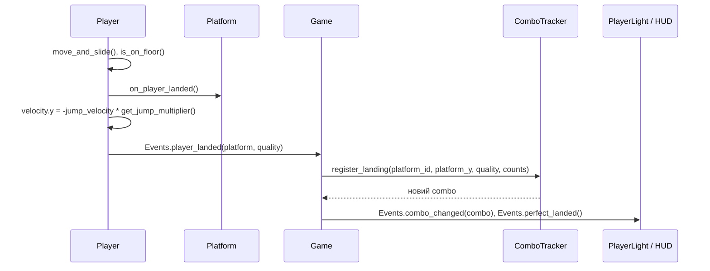

# Архітектура

Мета архітектури MVP — бути простою для новачка і водночас дозволяти додавати нові типи плиток, біоми та здібності без переписування ядра.

## 1. Ключові рішення

| Рішення | Чому |
|---|---|
| Godot 4.7, GDScript | Простий Python-подібний синтаксис, сцени в текстовому форматі (зручно для Claude Code), вбудоване 2D-світло. |
| Рендерер Compatibility | Найширша підтримка Android-пристроїв; підтримує `PointLight2D` і `CanvasModulate`. |
| Рух героя через `CharacterBody2D`, без фізичної симуляції | Повний контроль над відчуттям стрибка; передбачувано й легко тюнити. |
| Плитки — `AnimatableBody2D` з односторонньою колізією | Одна база для нерухомих і рухомих плиток; рухома плитка коректно «везе» героя. |
| Параметри балансу в `GameConfig` (Resource, `.tres`) | Тюнінг в інспекторі редактора без правки коду; одне джерело правди. |
| Шина подій `Events` (autoload) | Системи не знають одна про одну; легко додавати нові слухачі (звук, аналітика). |
| Чиста логіка окремо від сцен (`logic/`) | Логіку можна тестувати headless без запуску гри. |
| Власний мінімальний тест-раннер замість плагіна | Нуль залежностей; достатньо для MVP. За потреби пізніше перейти на GUT або gdUnit4. |
| Перехід між екранами через `change_scene_to_file` | Найпростіший і зрозумілий спосіб; для MVP достатньо. |
| Без пулінгу об’єктів у MVP | Плиток на екрані мало; `queue_free()` простіший. Пулінг — оптимізація на потім. |

## 2. Структура проєкту

```
spark-climb/
├── CLAUDE.md
├── docs/                         # документація (українською)
├── project.godot
├── .gitignore
├── config/
│   ├── game_config.gd            # class_name GameConfig extends Resource
│   └── game_config.tres          # значення параметрів (з GAME_SPEC §13)
├── autoload/
│   ├── events.gd                 # шина сигналів (autoload «Events»)
│   └── save_manager.gd           # рекорди у user://save.cfg (autoload «SaveManager»)
├── logic/                        # чиста логіка, без сцен — покрита тестами
│   ├── landing_math.gd           # оцінка якості приземлення
│   ├── combo_tracker.gd          # правила комбо (RefCounted)
│   ├── difficulty_curve.gd       # параметри складності за висотою
│   └── platform_picker.gd        # зважений вибір типу плитки з правилами
├── player/
│   ├── player.tscn
│   ├── player.gd                 # рух, автостриб, wrap, приземлення
│   ├── touch_input.gd            # перетворює драг у горизонтальне зміщення
│   └── player_light.gd           # радіус світла від комбо, пульс
├── platforms/
│   ├── platform.tscn             # базова сцена
│   ├── platform.gd               # class_name Platform — базовий клас
│   ├── static_platform.tscn
│   ├── moving_platform.tscn / .gd
│   ├── crumbling_platform.tscn / .gd
│   ├── spring_platform.tscn / .gd
│   └── start_platform.tscn
├── game/
│   ├── game.tscn                 # сцена забігу
│   ├── game.gd                   # стан забігу, зв’язування систем
│   ├── camera_controller.gd      # слідування + автопрокрутка
│   ├── platform_generator.gd     # створення/видалення плиток
│   └── darkness_band.gd          # візуальна смуга темряви
├── ui/
│   ├── main_menu.tscn / .gd      # головна сцена проєкту
│   ├── hud.tscn / .gd
│   ├── pause_menu.tscn / .gd
│   ├── game_over.tscn / .gd
│   └── floating_text.tscn / .gd  # «Ідеально!»
├── assets/
│   ├── light_texture.tres        # GradientTexture2D (радіальний градієнт)
│   └── fonts/                    # лише якщо стандартний шрифт не покриває кирилицю
└── tests/
    ├── test_runner.gd            # extends SceneTree; запускає всі test_*.gd
    ├── test_case.gd              # базовий клас з assert-функціями
    ├── test_landing_math.gd
    ├── test_combo_tracker.gd
    ├── test_difficulty_curve.gd
    ├── test_platform_picker.gd
    └── test_save_manager.gd
```

## 3. Дерево сцени забігу

```
Game (Node2D) — game.gd
├── CanvasModulate              # темрява (ambient_color)
├── Background (ColorRect / Polygon2D у CanvasLayer -1)
├── Platforms (Node2D)          # сюди генератор додає плитки
├── PlatformGenerator (Node) — platform_generator.gd
├── Player (CharacterBody2D) — player.gd
│   ├── CollisionShape2D (CircleShape2D)
│   ├── Body (Polygon2D, unshaded material)
│   ├── TouchInput (Node) — touch_input.gd
│   └── Light (PointLight2D) — player_light.gd
├── Camera (Camera2D) — camera_controller.gd
│   └── DarknessBand (Node2D) — darkness_band.gd
└── UI (CanvasLayer)
    ├── HUD
    ├── PauseMenu (прихований)
    └── GameOver (прихований)
```

## 4. Відповідальності

| Модуль | Відповідає за | Не відповідає за |
|---|---|---|
| `game.gd` | Стан забігу (`READY → PLAYING → PAUSED → GAME_OVER`), перевірку програшу, рахунок висоти, зв’язування систем, запуск автопрокрутки (`camera.start_scroll()`), рестарт | Рух героя, генерацію, вигляд UI |
| `player.gd` | Гравітацію, горизонтальний рух, wrap, виявлення приземлення, відскок, емісію `player_landed` | Підрахунок комбо, рахунок |
| `touch_input.gd` | Накопичення горизонтального драгу першого пальця і клавіатурного введення; видає зміщення за кадр | Рух героя напряму |
| `player_light.gd` | Плавну зміну радіуса за комбо, пульс | Логіку комбо |
| `camera_controller.gd` | Слідування, автопрокрутку (вмикається викликом `start_scroll()`), межі видимої зони (`get_top_y()`, `get_bottom_y()`) | Перевірку програшу, рішення, коли починати прокрутку |
| `platform_generator.gd` | Створення плиток наперед і видалення під камерою, використовуючи `DifficultyCurve` і `PlatformPicker`; задає ширину плитки при створенні | Поведінку плиток |
| `Platform` і нащадки | Власну поведінку (рух, розсипання, пружина), множник стрибка | Знання про героя, крім виклику `on_player_landed` |
| `ComboTracker` | Правила комбо, найкраще комбо, лічильник ідеальних | Світло, UI |
| `LandingMath` | Обчислення якості приземлення | Стан |
| `DifficultyCurve` | Діапазони проміжків, ваги типів, швидкість рухомих і прокрутки за висотою | Випадковість |
| `PlatformPicker` | Зважений вибір типу з правилами (безпечний старт, без двох крихких поспіль) | Позиціонування |
| `SaveManager` | Читання/запис рекордів у `user://save.cfg`, версіонування й міграції формату, обробку відсутнього чи пошкодженого файлу (§10a) | Ігрову логіку |
| UI-сцени | Відображення даних із сигналів, кнопки | Ігровий стан напряму (лише через `Events` або виклики `Game`) |

## 5. Базовий клас плитки

```gdscript
## Base class for every platform. Subclasses override behavior hooks.
class_name Platform
extends AnimatableBody2D

enum Kind { START, STATIC, MOVING, CRUMBLING, SPRING }

@export var kind: Kind = Kind.STATIC
## Set by PlatformGenerator on spawn (GameConfig.platform_size.x,
## or the visible area width for the start platform).
var width: float = 0.0

## Velocity multiplier applied to the player's bounce.
func get_jump_multiplier() -> float:
    return 1.0

## Called by the player right after landing on this platform.
func on_player_landed() -> void:
    pass

## Whether landings on this platform count for the combo.
func counts_for_combo() -> bool:
    return kind != Kind.START
```

Нащадки перевизначають лише те, що їм потрібно: `SpringPlatform` — `get_jump_multiplier()` і `on_player_landed()` (анімація), `CrumblingPlatform` — `on_player_landed()` (вимкнути колізію, анімація, `queue_free`), `MovingPlatform` — `_physics_process()`.

## 6. Шина подій `Events`

| Сигнал | Хто емітить | Хто слухає |
|---|---|---|
| `run_started()` | Game | HUD |
| `player_landed(platform: Platform, quality: int)` | Player | Game → ComboTracker, FloatingText, вібрація |
| `combo_changed(combo: int)` | Game (з ComboTracker) | PlayerLight, HUD |
| `perfect_landed()` | Game | PlayerLight (пульс), FloatingText |
| `height_changed(meters: int)` | Game | HUD |
| `run_paused()` / `run_resumed()` | Game | PauseMenu |
| `run_ended(stats: Dictionary)` | Game | GameOver, SaveManager |

`stats` містить ключі `height`, `best_combo`, `perfect_count`, `is_new_record`.

**Правило «call down, signal up».** Сигнали йдуть угору (дочірній вузол повідомляє, що сталося), а батьківський вузол керує дочірніми прямими викликами методів. Тому `Game` не шле камері подію, а сам викликає `camera.start_scroll()`.

## 7. Потік приземлення



Якість приземлення обчислює `LandingMath.evaluate(player_x, platform_x, platform_width, perfect_zone_ratio)`, що повертає `PERFECT` або `NORMAL`.

## 8. Камера і перевірка програшу

Прокрутка вимкнена до виклику `start_scroll()`. Його робить `Game` в обробнику `Events.player_landed`, коли герой уперше приземлився на нестартову плитку. `CameraController` у `_process` спершу піднімає верхню межу на `scroll_speed × delta` (якщо прокрутка активна), потім, якщо герой вище лінії слідування, підтягує камеру до нього. Позиція камери лише зменшується за Y. Висота екрана для лінії слідування й меж зони береться з фактичної видимої області (`get_viewport().get_visible_rect().size.y`), а не з константи 1280. `Game` кожен кадр порівнює верх героя з `camera.get_bottom_y()` і за потреби запускає завершення забігу.

## 9. Генерація

`PlatformGenerator` зберігає Y останньої створеної плитки. Поки ця Y нижча за `camera.get_top_y() − spawn_ahead_screens × screen_height`, він:

1. бере з `DifficultyCurve` параметри для висоти нової плитки;
2. обирає вертикальний проміжок і горизонтальну позицію;
3. просить у `PlatformPicker` тип (з урахуванням попереднього типу і номера плитки);
4. інстанціює відповідну сцену з мапи `Kind → PackedScene` і налаштовує її (ширина з `platform_size`, швидкість, напрямок).

`screen_height` тут — фактична висота видимої області. Стартову плитку генератор створює з шириною, що дорівнює ширині видимої області.

Плитки нижче `camera.get_bottom_y() + despawn_margin` видаляються. Генератор використовує власний `RandomNumberGenerator` із seed.

## 10. Конфігурація

`GameConfig` — `Resource` з полями, згрупованими через `@export_group` (Герой, Керування, Плитки, Комбо, Світло, Камера, Генерація, Відчуття). Таблиця рівнів складності — масив словників або окремих Resource `DifficultyTier`. Сцени отримують конфіг через `@export var config: GameConfig`, куди в редакторі підставлено `config/game_config.tres`. Чисті класи з `logic/` отримують потрібні значення параметрами, а не читають конфіг самі.

## 10a. Збереження прогресу

**Де і як.** `SaveManager` (autoload) зберігає дані у `user://save.cfg` через `ConfigFile`. На Android `user://` — приватна тека застосунку у внутрішній пам’яті: файл переживає перезапуски й оновлення, але зникає при видаленні гри або очищенні її даних.

**Формат (версія 1):**

```ini
[meta]
save_version=1

[records]
best_height=157
best_combo=12
```

**Версіонування.** Константа `SaveManager.CURRENT_VERSION` дорівнює поточній версії формату. Під час завантаження:

1. Файл відсутній → дані за замовчуванням (усі рекорди 0), нічого не записується до першого рекорду.
2. Файл не читається (`ConfigFile.load()` повертає помилку) → дані за замовчуванням; пошкоджений файл перейменовується на `save.cfg.bak` (для діагностики), гра продовжує роботу. Помилка лише пишеться в лог через `push_warning`.
3. `save_version` менша за поточну → послідовно застосовуються міграції `_migrate_v1_to_v2()`, `_migrate_v2_to_v3()` тощо, після чого файл одразу перезаписується в новому форматі. Міграції лише **додають** або перейменовують поля, але ніколи не обнуляють рекорди.
4. `save_version` більша за поточну (файл від новішої версії гри) → дані читаються як є, невідомі поля ігноруються й зберігаються без змін.
5. Відсутні окремі ключі → для них використовується значення за замовчуванням (`ConfigFile.get_value(section, key, default)`).

**Надійний запис.** Щоб збій посеред запису (наприклад, телефон вимкнувся) не зіпсував рекорди, запис іде у тимчасовий файл `save.cfg.tmp`, і лише після успішного запису він замінює основний через `DirAccess.rename_absolute()`.

**API:**

```gdscript
func get_best_height() -> int
func get_best_combo() -> int
## Updates records if the run beat them; saves only when something changed.
## Returns true when at least one record was beaten.
func submit_run(height: int, best_combo: int) -> bool
```

Шлях до файлу задається змінною (`save_path`), щоб тести могли працювати з окремим файлом і не чіпати справжні рекорди.

**Як додати нове поле після MVP** (валюта, скіни, налаштування): збільшити `CURRENT_VERSION`, дописати функцію міграції зі значенням за замовчуванням для нового поля, додати тест міграції зі старого формату.

## 11. Тести

`tests/test_runner.gd` наслідує `SceneTree`. У `_init()` він знаходить усі `tests/test_*.gd`, створює екземпляри, викликає методи з префіксом `test_`, друкує підсумок і завершується з кодом `0` (успіх) або `1` (є провали). `test_case.gd` надає `assert_eq`, `assert_true`, `assert_almost_eq`.

Мінімальний набір тестів:

- `LandingMath`: центр → PERFECT; межа зони → PERFECT; за межею → NORMAL; симетрія ліворуч/праворуч.
- `ComboTracker`: PERFECT збільшує; NORMAL не змінює; падіння скидає; падіння на стартову плитку теж скидає; повторна плитка не рахується; стартова не додає; найкраще комбо і лічильник ідеальних.
- `DifficultyCurve`: правильний рівень на межах висот (нижня межа включно: 29.9 м → рівень 1, 30 м → рівень 2; так само 100 і 200 м); максимальний проміжок ≤ 80% висоти стрибка на всіх рівнях; швидкість прокрутки обмежена максимумом.
- `PlatformPicker`: перші N — лише кам’яні; ніколи дві крихкі поспіль (перевірка на 10 000 виборах); частоти близькі до ваг.
- `SaveManager` (з тестовим `save_path`): перший запуск без файлу → нулі; запис і повторне читання; рекорд не перезаписується гіршим результатом; пошкоджений файл → нулі й `.bak`; відсутній ключ → значення за замовчуванням; файл без `save_version` трактується як версія 1.

## 12. Як додати новий тип плитки (точка розширення)

1. Додати значення в `Platform.Kind`.
2. Створити сцену-нащадка від `platform.tscn` і скрипт, що наслідує `Platform`, перевизначивши потрібні хуки.
3. Додати колір і параметри в `GameConfig`.
4. Додати вагу типу в рівні складності й правила в `PlatformPicker` (якщо потрібні).
5. Зареєструвати сцену в мапі генератора, додати тести правил і описати тип у `GAME_SPEC.md`.

## 13. Продуктивність

- Одне джерело світла (`PointLight2D`), тіні вимкнено.
- Плитки поза зоною видаляються; на екрані одночасно до ~20 плиток.
- Жодних `get_node` у `_process`: посилання кешуються через `@onready`.
- Перевірка FPS — через debug-оверлей (FR-18) на реальному телефоні.
